# Writing Prompt App

A personal writing app that gives you a daily writing prompt, with streaks, a challenge mode and a word bank.

- **Try the working app:** https://laurenlliu.github.io/writing-prompt-app/app/ (open it on a phone)
- **See every screen:** https://laurenlliu.github.io/writing-prompt-app/ (pictures are in `images/`)

## What works

Only the screens and choices Allison has drawn or confirmed are in the app.

- **Welcome:** the first screen a new user sees, with Answer onboarding questions, Explore app (use the app without an account) and Sign-in.
- **Sign-up:** sign up or sign in with Google, or with an email and password. Your writing is then saved to your account (Firebase) and comes back on any phone you sign in on.
- **Onboarding:** what you like to write about, the topics you like, and how the app can help. Change your answers anytime from your profile.
- **AI prompts:** each prompt is written by AI from your topics and what you like to write about. If the AI is busy, the prompts in `app/data.js` are used instead.
- **Make a choice → Prompt → Write → Congrats.** You get 3 re-spins a day, then the button greys out.
- **Levels:**

| Level | Word bank words | Word minimum | Timer |
| --- | --- | --- | --- |
| Easy | 4 | 200 | 15 min |
| Medium | 6 | 350 | 10 min |
| Hard | 8 | 550 | 7 min |
| Daily challenge | 4 | 300 | none |

- **Write:** word count, timer, the prompt (tap Prompt) and the word bank. Used words are underlined in your writing and crossed out in the word bank. You need at least 3 word bank words to finish. Save for later keeps your story.
- **Challenge mode** goes straight to a challenge prompt. **Complete daily challenge** gives everyone the same prompt that day.
- **Profile, See past entries (organize by date, mode or word count) and Writing stats.**
- **Add to Home Screen** and it opens full screen like a real app, even offline. The icon is a placeholder until the logo is drawn.

Not designed yet, so they don't do anything: Explore prompts, Memories, Favorite entries, tapping an old entry and this week's ratings.

## Files

- `app/index.html`: all the screens.
- `app/styles.css`: colors, fonts and button styles. Change a color once at the top and every screen updates.
- `app/data.js`: the prompts, word bank lists and word definitions.
- `app/app.js`: how everything works. The rules (words per level, word minimums, timers, re-spins per day) are at the top.
- `app/cloud.js`: saving to your account with Firebase (see `SETUP-CLOUD.md`).
- `worker/worker.js`: the AI prompt writer that runs on Cloudflare (see `SETUP-AI.md`).
- `app/manifest.webmanifest`, `app/sw.js` and `app/icons/`: what makes the app installable and work offline.

## Colors and fonts

| Use | Color |
| --- | --- |
| Yellow | `#eedda3` |
| Orange (peach) | `#ecc2b0` |
| Pink | `#eea9bc` |
| Background (cream) | `#FBF7EE` |
| Text (warm brown) | `#3A2E2A` |
| Light text | `#7A6A62` |

Headings use **Fraunces** and everything else uses **DM Sans** (both free on Google Fonts).

## Screens

| Welcome | Sign-up | Onboarding 1 | Onboarding 2 | Onboarding 3 |
| --- | --- | --- | --- | --- |
| 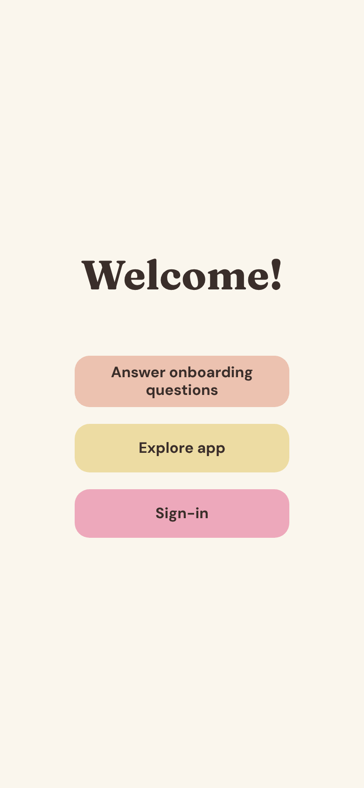 | 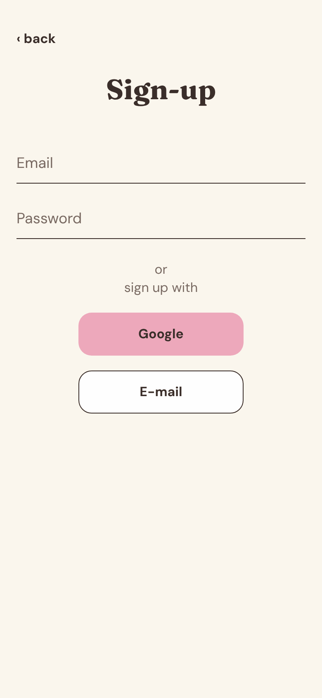 | 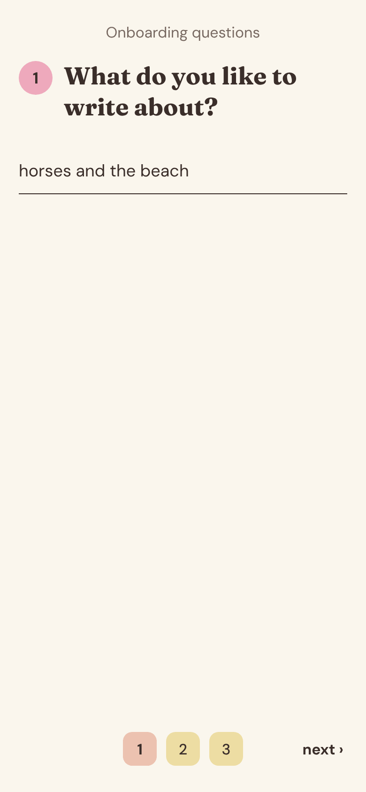 | 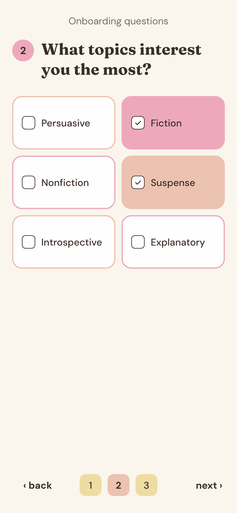 | 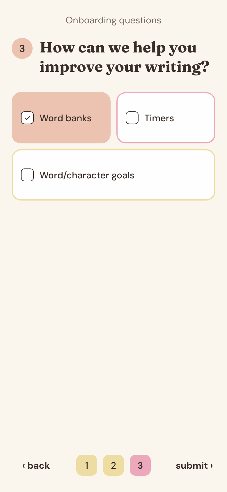 |

| Home | Make a choice | Prompt | Write |
| --- | --- | --- | --- |
| 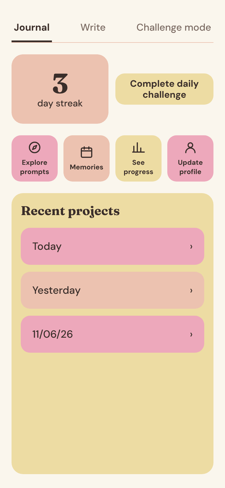 | 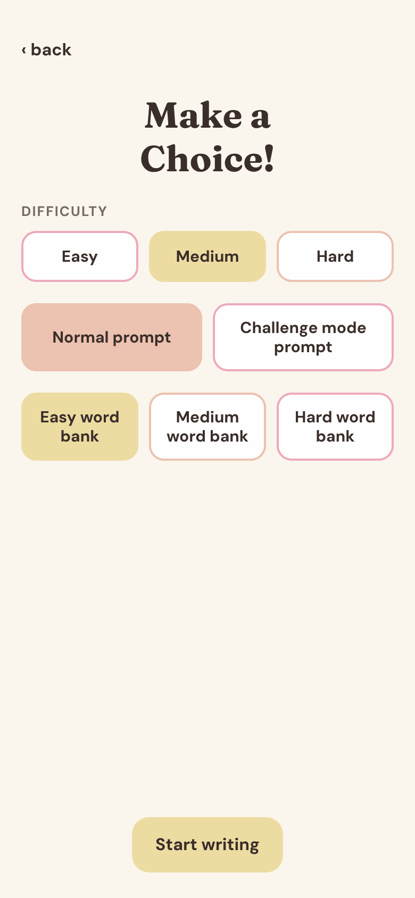 | 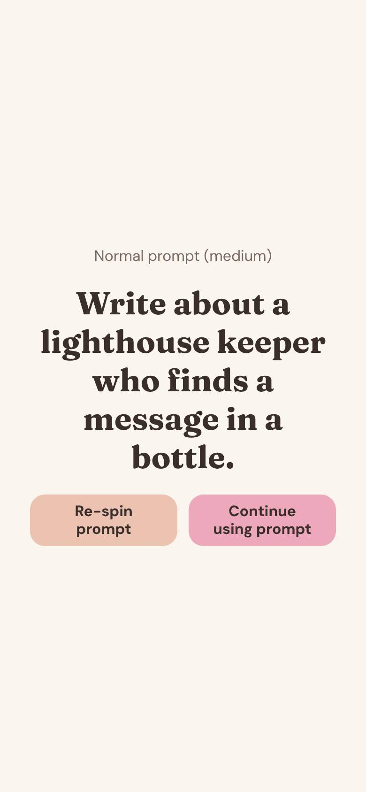 | 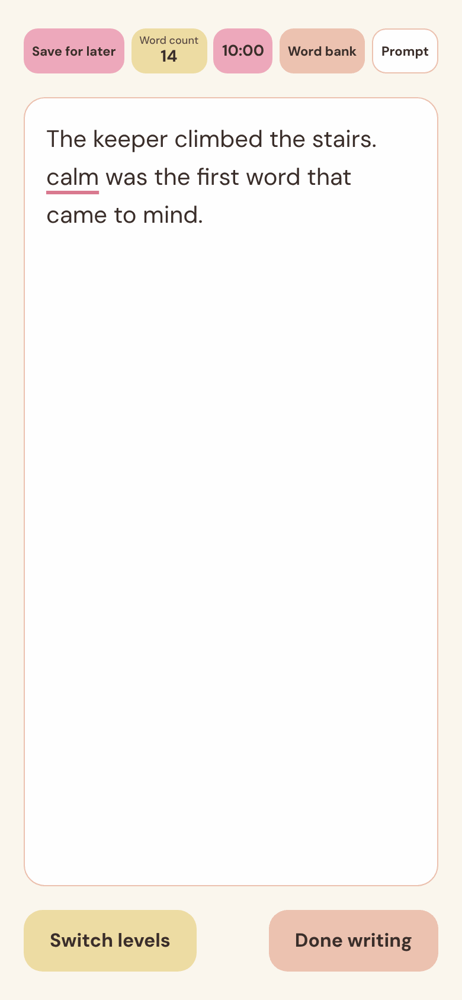 |

| Prompt open | Word bank open | Congrats | Daily challenge |
| --- | --- | --- | --- |
| 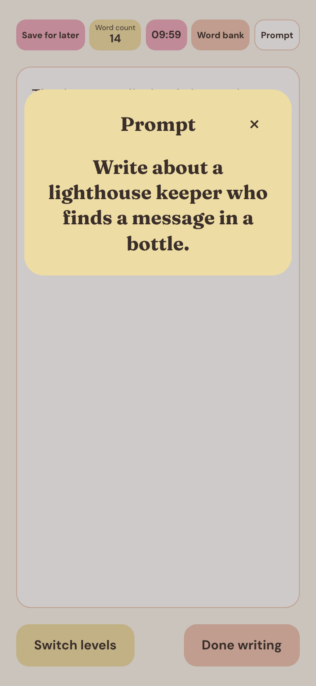 | 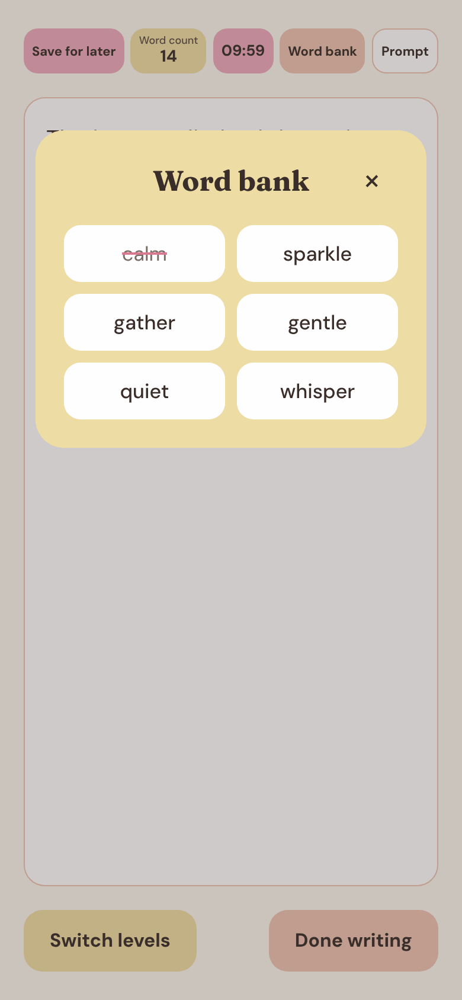 | 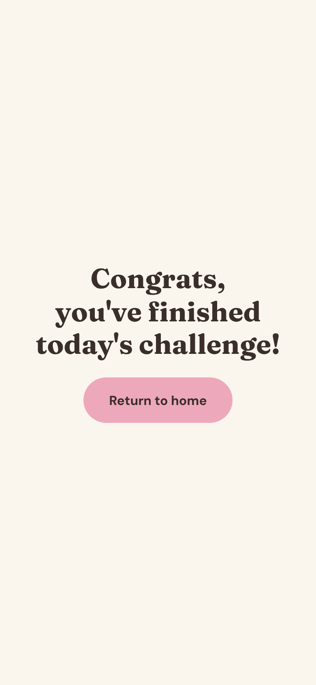 | 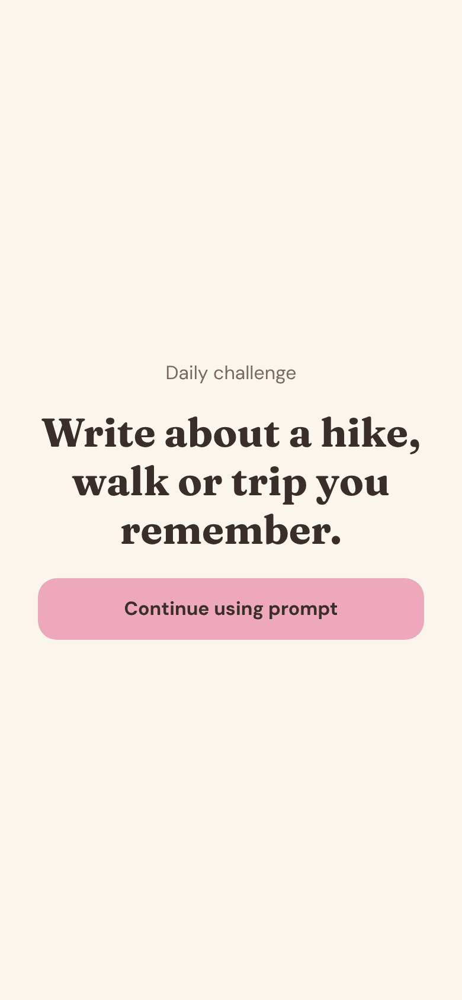 |

| Profile | See past entries | Organize by | Writing stats |
| --- | --- | --- | --- |
| 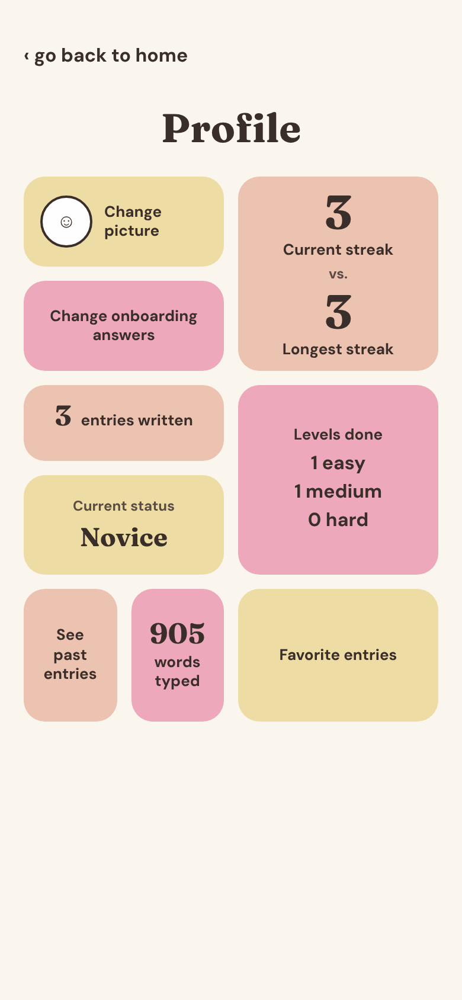 | 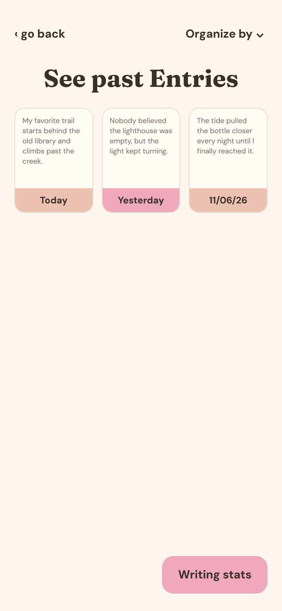 | 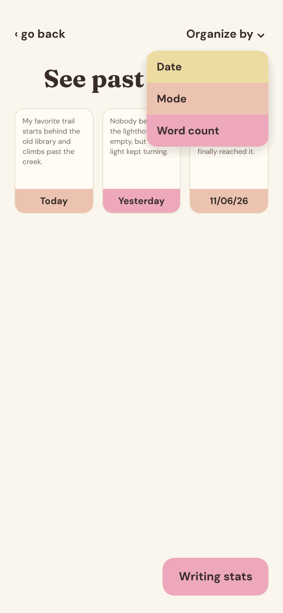 | 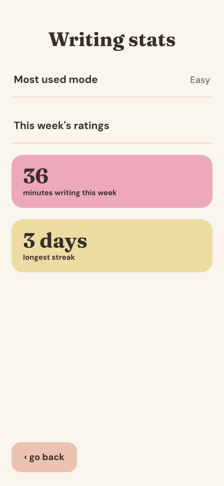 |
