# Writing Prompt App: Screen Designs

Designs for a personal writing app that gives you a daily writing prompt, with streaks, a challenge mode and a word bank.

To try the screens, open `index.html` in a browser (or turn on GitHub Pages for this repo). Every screen is a plain HTML file in `screens/`, and the pictures below are in `images/`.

## Colors and fonts

| Use | Color |
| --- | --- |
| Yellow | `#eedda3` |
| Orange (peach) | `#ecc2b0` |
| Pink | `#eea9bc` |
| Background (cream) | `#FBF7EE` |
| Text (warm brown) | `#3A2E2A` |
| Light text | `#7A6A62` |

Headings use **Fraunces** and everything else uses **DM Sans** (both free on Google Fonts).

## Onboarding

Option boxes start with just a colored outline. When you tap one, it fills in with its color and the checkbox gets a check mark.

| 1. Main goal | 2. Topics | 3. Writing help |
| --- | --- | --- |
| 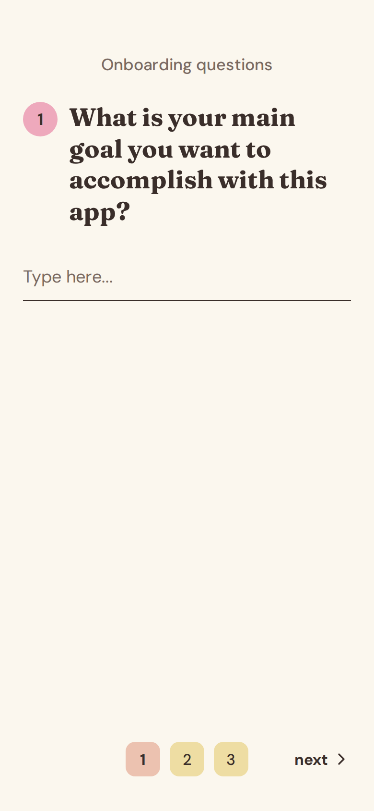 | 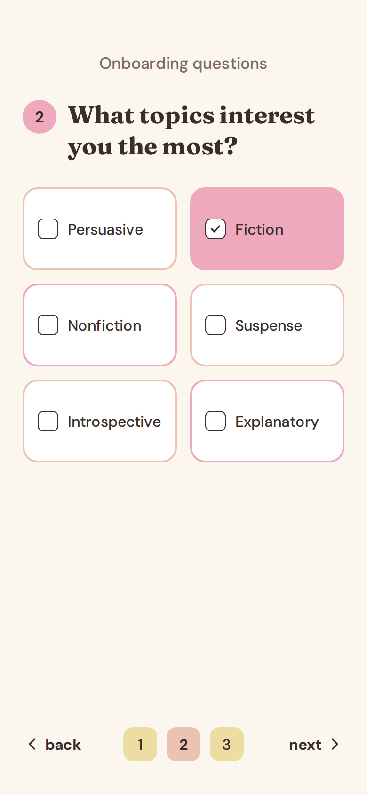 | 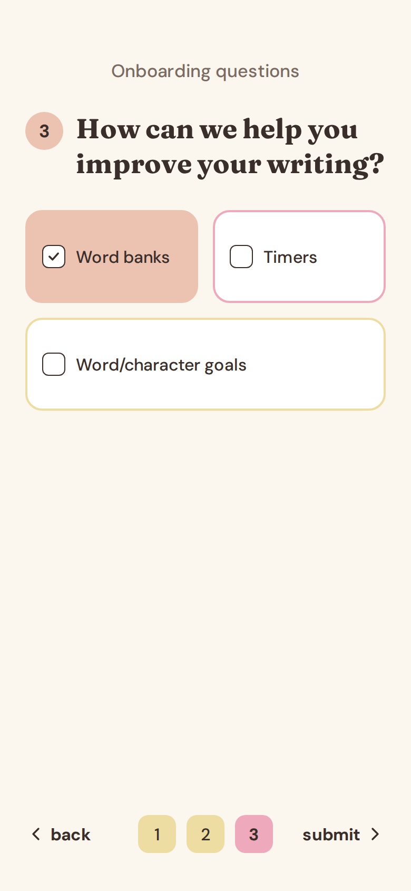 |

## Main app

The flow: Home → Make a choice → Prompt → Write → Challenge complete.

| Home | Make a choice | Prompt |
| --- | --- | --- |
| 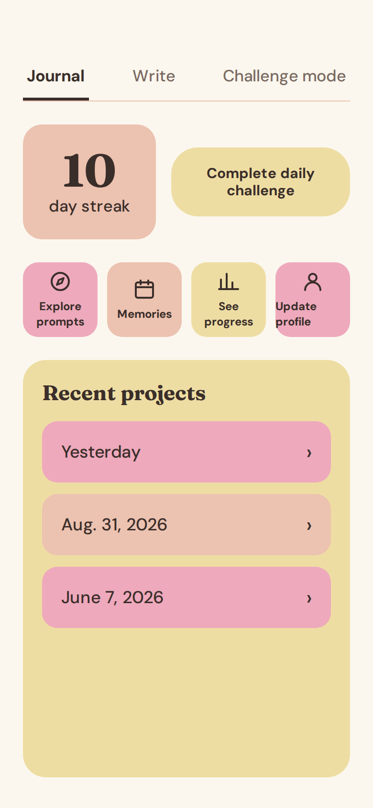 | 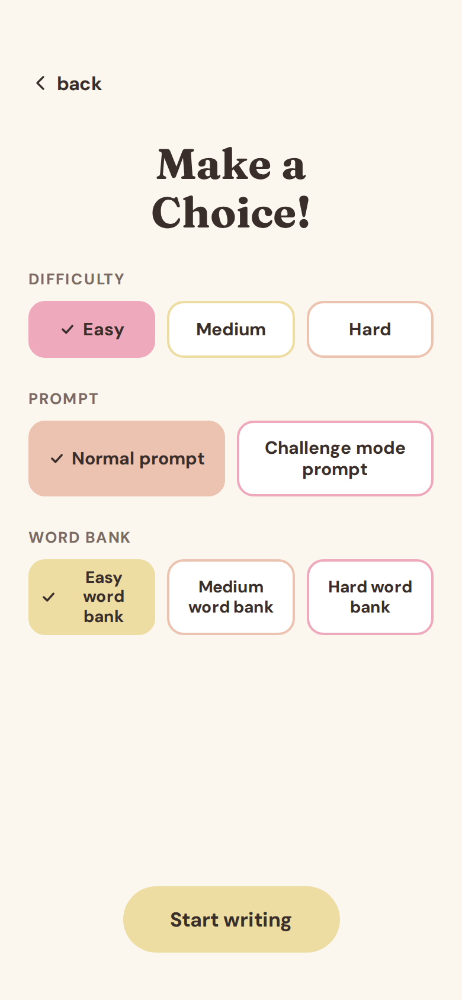 | 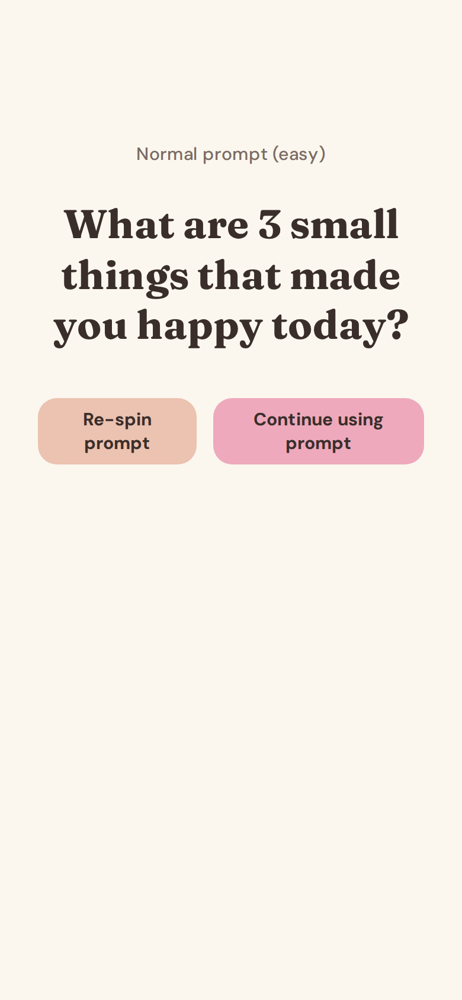 |

| Write | Write, word bank open | Challenge complete |
| --- | --- | --- |
| 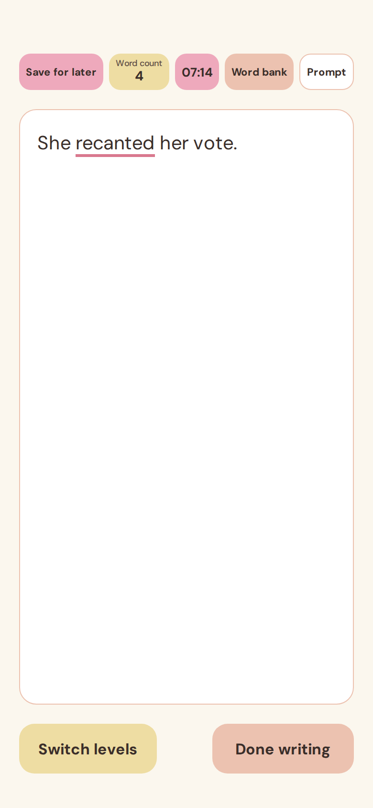 | 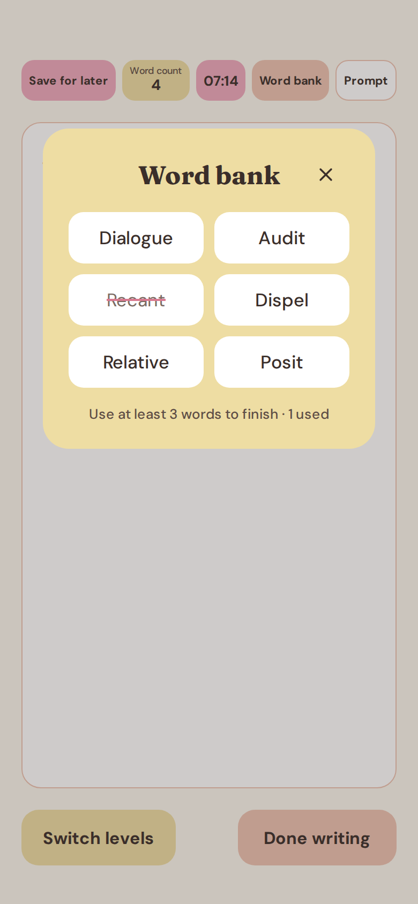 | 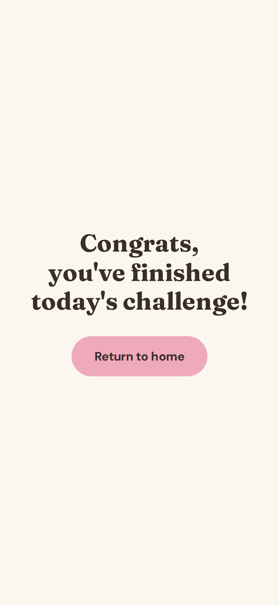 |

## Profile

From the home screen, tap **Update profile** to open your profile. From there you can see your past entries and your writing stats.

| Profile | See past entries | Organize by, open | Writing stats |
| --- | --- | --- | --- |
| 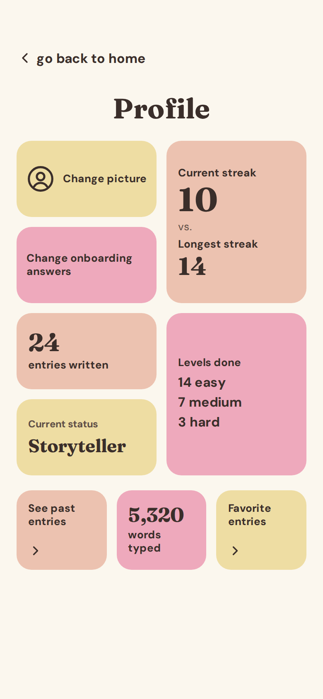 | 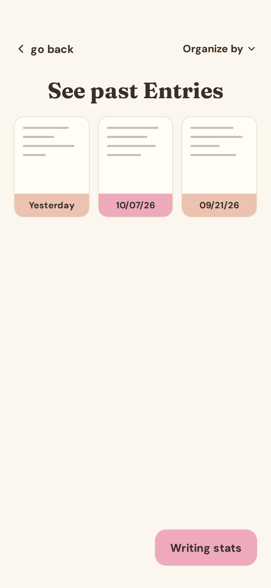 | 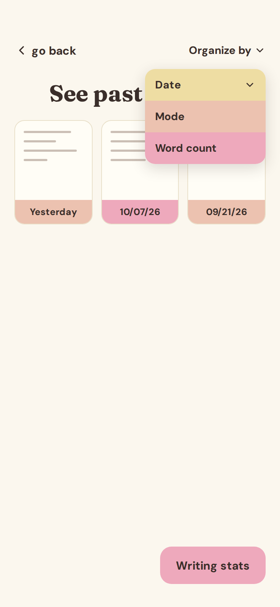 | 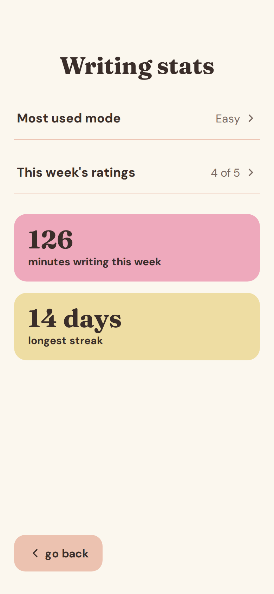 |

- **Profile:** change your picture (pick a drawn icon or upload a photo), change your onboarding answers, and see your current vs. longest streak, entries written, current status (novice, wordsmith or storyteller), levels done, words typed and favorite entries.
- **See past entries:** your entries as little pages with the date underneath. Organize them by date, mode or word count.
- **Writing stats:** most used mode, this week's ratings, minutes spent writing and longest streak.

## How challenge mode should work

- You pick a difficulty, a prompt type (normal or challenge mode) and a word bank every day. The app doesn't remember your last choice.
- **Easy:** 4 word bank words.
- **Medium:** 6 word bank words and a word count minimum.
- **Hard:** 8 word bank words, a word count minimum and a timer.
- Harder levels get more words, not harder words.
- You see your word bank words before you start writing.
- If you don't like the prompt, you can re-spin it 3 or 4 times.
- You can go back to the home screen without starting.

## How the Write screen should work

- The screen opens straight to the writing space, so you can start typing right away.
- The prompt and word bank stay hidden so the screen feels calm and empty. Tap **See prompt** or **Word bank** to bring them back.
- The app marks a word bank word as used: it gets underlined in your writing and crossed out in the word bank.
- The word count is always visible.
- **Save for later** keeps your work so you can come back to it.
- You don't have to use every word bank word, but you need to use at least 3 before you can finish.
- When you finish, you see "Congrats, you've finished today's challenge!" with a button back to the home page.

## Still to decide

- What happens if you tap Done writing with fewer than 3 word bank words used.
- The exact number of prompt re-spins (3 or 4) and how many are left.
- How status badges are earned (number of entries, streaks, or points).
- What the screen for reading one old entry looks like.
- Coming next: the app logo and drawn profile icons.
